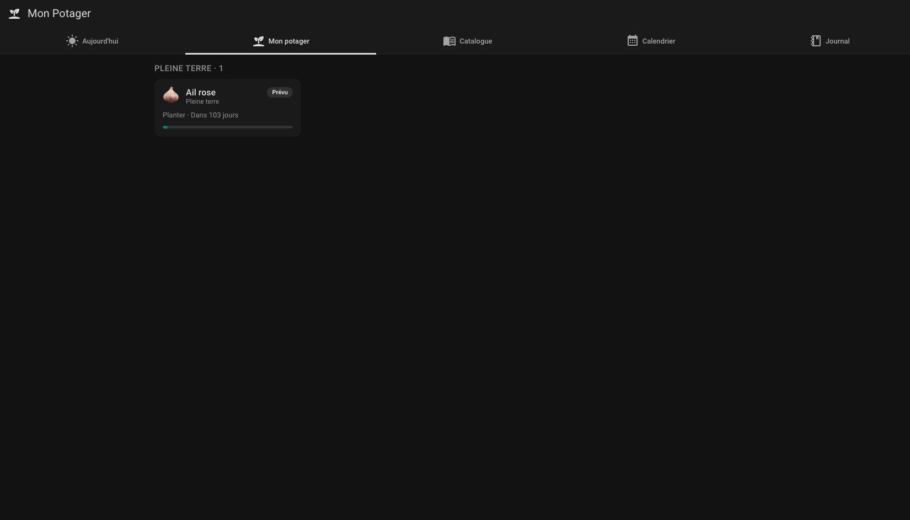
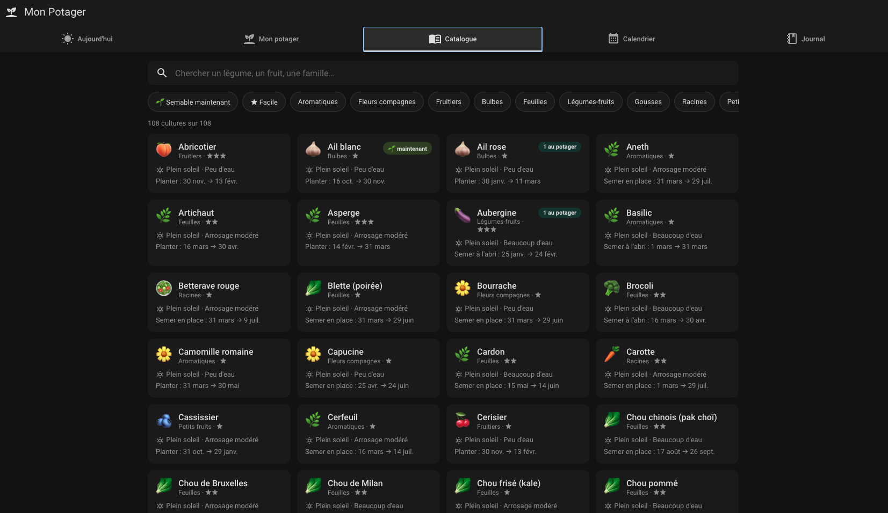

# Mon Potager

[](https://my.home-assistant.io/redirect/hacs_repository/?owner=MaximeRiviere56&repository=ha-potager&category=integration)

Une intégration Home Assistant pour gérer un potager : choisir ses légumes dans
un catalogue de 108 cultures, les suivre dans un jardin virtuel, et recevoir au
bon moment un rappel pour semer, repiquer ou récolter.

> **L'idée centrale.** Le calendrier n'est pas une fiche théorique figée : il
> est piloté par ce qui s'est vraiment passé. Vous semez vos tomates trois
> semaines en retard ? La date de récolte se décale de trois semaines. Et la
> plante déjà semée ne vous réclamera plus jamais de la semer.

## Ce que ça donne

**Un panneau « Mon Potager » dans la barre latérale**, avec six vues :
Aujourd'hui, Mon potager, Catalogue, Calendrier, Journal et Réglages.



Chaque plante montre sa phase, sa zone et son échéance suivante. La barre de
progression se remplit pendant la fenêtre en cours.



Les 108 fiches, filtrables. Le filtre **Semable maintenant** répond à la seule
question qui compte devant un catalogue de cette taille : qu'est-ce que je peux
mettre en terre ce week-end ? Les dates affichées sont calculées depuis vos
propres gelées.

**Des entités** pour vos tableaux de bord et vos automatisations :

| Entité | Rôle |
|---|---|
| `sensor.mon_potager_actions_a_mener` | Nombre d'actions du jour, détail en attributs |
| `sensor.mon_potager_recolte_de_la_saison` | Total récolté en kg (`state_class: total`, exploitable dans les statistiques) |
| `sensor.<plante>` | Phase de la plante, et toute sa fiche en attributs |
| `switch.rappels_<plante>` | Rappels de cette plante — automatisable (« coupe tout pendant les vacances ») |
| `calendar.mon_potager` | Étapes prévues **et** journal passé |
| `todo.mon_potager` | Tâches en cours — **cocher enregistre l'événement** |

**Une carte Lovelace** `custom:potager-card` pour votre tableau de bord principal.

## Le suivi réel, sans formulaire

Un journal qu'on doit tenir à la main ne se tient pas. Il y a donc trois chemins
pour enregistrer un geste, et aucun ne demande de saisir une date :

1. le bouton **« C'est fait »** sur la notification ;
2. la **case à cocher** de `todo.mon_potager` ;
3. le bouton **« Fait »** sur la carte Lovelace ou dans le panneau.

Chacun inscrit l'événement au journal à la date du jour, ce qui recalcule
immédiatement la suite du cycle.

```
prévu ──semé le──▶ semé ──repiqué le──▶ planté ──1ʳᵉ récolte──▶ en récolte ──▶ terminé
                     │                     │
                     └─ repiquage prévu    └─ récolte prévue
                        = cette date + jours_semis_a_repiquage
```

Les récoltes se cumulent : un plant de tomates se récolte vingt fois, et vous
obtenez un total par culture et par saison. `potager.annuler_dernier_evenement`
défait la dernière entrée — on se trompe toujours une fois.

## Installation

### En un clic

[](https://my.home-assistant.io/redirect/hacs_repository/?owner=MaximeRiviere56&repository=ha-potager&category=integration)

Ce bouton ouvre HACS sur votre propre instance avec le dépôt déjà renseigné :
il ne reste qu'à télécharger, redémarrer, puis ajouter l'intégration.

> Il s'appuie sur [My Home Assistant](https://my.home-assistant.io/). Au premier
> usage, votre navigateur vous demandera l'adresse de votre instance ; elle
> reste stockée dans ce navigateur et n'est transmise à personne.

### À la main, dans HACS

1. HACS → menu ⋮ → **Dépôts personnalisés**
2. URL `https://github.com/MaximeRiviere56/ha-potager`, catégorie **Integration**
3. Installer **Mon Potager**, puis redémarrer Home Assistant
4. **Paramètres → Appareils et services → Ajouter une intégration → Mon Potager**

### Sans HACS

Copier `custom_components/potager/` dans le dossier `config/` de Home
Assistant, redémarrer, puis ajouter l'intégration.

### La carte Lovelace

Le fichier est servi par l'intégration. L'ajouter dans **Paramètres →
Tableaux de bord → Ressources** :

- URL : `/potager-frontend/potager-card.js`
- Type : **Module JavaScript**

```yaml
type: custom:potager-card
titre: Au potager
max: 5
```

## Réglages

Tout se règle depuis l'onglet **Réglages** du panneau, sans passer par les
pages de configuration de Home Assistant.

### Saison et gelées

Les deux dates qui calent **tout** le calendrier. Un préréglage climatique
(Ouest océanique, Nord et Est, Midi, Montagne) les remplit, ou vous saisissez
les vôtres. Les modifier redessine immédiatement les 108 fiches.

### Rappels

Quatre niveaux de granularité, du plus large au plus fin :

| Niveau | Réglage |
|---|---|
| **À qui** | les applications mobiles qui reçoivent les rappels, et/ou une notification interne à Home Assistant |
| **Quoi** | quelles étapes méritent un rappel — semis à l'abri, semis en place, repiquage, plantation, récolte |
| **Quand** | l'heure de la vérification, le délai d'anticipation, et la relance pendant la récolte |
| **Comment** | un message par plante, ou un seul message groupé |

Deux réglages méritent un mot.

**La relance de récolte.** Une courgette se cueille tous les deux jours :
prévenir une seule fois ne sert à rien. Mettez 2 et le rappel revient tant que
la fenêtre est ouverte. À 0, un unique rappel par récolte.

**Le message groupé.** Au printemps, cinq rappels le même matin sont cinq
rappels qu'on balaie sans lire. Le revers : un message groupé ne peut pas
porter de bouton « C'est fait », puisqu'il faudrait deviner de quelle plante
il s'agit.

Au-dessous, chaque plante garde son propre interrupteur de rappels et peut
avoir son propre délai, dans sa fiche.

### Zones

Pleine terre, serre, châssis, balcon — ajoutez, renommez, supprimez. Chacune
porte un décalage en jours qui avance ou retarde tout le calendrier de ses
plantes. Il ne s'applique **jamais** à une date de votre journal : un fait
n'est pas une prévision.

### Mes fiches

Le catalogue livré ne contiendra jamais votre variété locale. Ajoutez-la :
nom, catégorie, exposition, eau, périodes **en mois** (comme sur un sachet de
graines) et durées du cycle. Ce sont ces durées qui permettent ensuite de
recalculer la récolte depuis votre date réelle de semis.

Vos fiches sont conservées dans le stockage de votre jardin, pas dans le
fichier livré : **une mise à jour de l'intégration ne les efface pas.** Elles
apparaissent dans le catalogue au milieu des autres, et une fiche utilisée par
une plante du jardin ne peut pas être supprimée par mégarde.

### Affichage

Masquer ou non les plantes terminées et perdues dans « Mon potager ». Elles
restent dans le journal et le calendrier : c'est l'historique du potager, il
ne s'efface pas.

## Configuration initiale

Deux réglages comptent vraiment.

**Vos dates de gelées.** Elles calent tout le calendrier. Le formulaire propose
des préselections climatiques (Ouest océanique, Nord et Est, Midi, Montagne) ;
vous pouvez aussi saisir vos dates au format `MM-JJ`. Aucune date n'est écrite
en dur dans le catalogue : tout est un décalage en jours par rapport à la
dernière gelée de printemps ou à la première gelée d'automne. C'est ce qui rend
le calendrier juste chez vous, et pas seulement en moyenne nationale.

**Les destinataires des rappels.** Choisissez vos applications mobiles : seuls
les services `notify.mobile_app_*` transportent des boutons d'action, et c'est
le bouton « C'est fait » qui remplit votre journal sans effort.

Tout cela se modifie ensuite depuis l'onglet **Réglages** du panneau.

## Le catalogue

108 cultures : légumes-fruits, racines, gousses, bulbes, feuilles, aromatiques,
petits fruits, arbres fruitiers et fleurs compagnes. Chaque fiche porte
l'exposition, les besoins en eau, le sol, l'espacement, la rusticité, les bons
et mauvais voisins, des conseils, et ses fenêtres culturales.

Le catalogue est **embarqué** : aucune API, aucun compte, aucun service externe
susceptible de disparaître. Il est extensible depuis le panneau (voir
[Mes fiches](#mes-fiches)). Les API publiques du domaine ont d'ailleurs mal
vieilli — OpenFarm est mort, Growstuff n'a jamais eu d'API officielle, et
Permapeople ne fournit pas de calendrier de semis.

Une culture gélive voit sa fenêtre de récolte plafonnée à la première gelée :
une courgette ne se récolte pas en janvier.

### Ajouter une culture

Les fiches vivent dans une table compacte, une ligne par culture :

```bash
$EDITOR tools/catalogue_source.py
python3 tools/build_catalog.py     # valide puis régénère data/catalog.json
```

La validation refuse une fiche dont la récolte ne serait pas calculable, dont un
compagnon n'existe pas, ou à qui il manque `rusticite.gel`.

## Services

| Service | Effet |
|---|---|
| `potager.ajouter_plante` | Ajoute une culture au jardin |
| `potager.retirer_plante` | La retire, avec son journal |
| `potager.marquer_seme` | Semis à sa date réelle (`mode` : `direct` ou `interieur`) |
| `potager.marquer_repique` | Mise en place |
| `potager.marquer_recolte` | Récolte, avec `quantite_g` facultatif |
| `potager.marquer_perdu` | Perte, avec sa `cause` |
| `potager.marquer_termine` | Clôt la culture |
| `potager.annuler_dernier_evenement` | Défait la dernière entrée du journal |
| `potager.rafraichir` | Recalcule tout de suite |

## Le logo

L'intégration embarque ses propres images de marque dans
`custom_components/potager/brand/` : icône et logo, en variantes claire et
sombre. Depuis Home Assistant 2026.3, un composant personnalisé peut les servir
lui-même, et elles priment sur le dépôt central
[home-assistant/brands](https://github.com/home-assistant/brands) — aucune pull
request à déposer, aucune attente de relecture.

Les sources SVG et la marche à suivre pour regénérer les PNG sont dans
[`tools/brand/`](tools/brand/).

## Développement

```bash
python3 -m unittest discover -s tests -p 'test_*.py'   # 62 tests, sans dépendance
```

`lifecycle.py` (le journal) et `phenology.py` (le calcul des étapes) n'importent
rien de Home Assistant : ils sont testables hors instance, et c'est là que vit
toute la logique qui coûterait cher si elle était fausse — un calendrier faux ne
se voit qu'une saison plus tard.

Le panneau et la carte se vérifient sans instance :

```bash
python3 tools/banc_fixture.py && python3 -m http.server 8777
# http://localhost:8777/tools/banc.html        — le panneau, cinq vues
# http://localhost:8777/tools/banc-carte.html  — la carte Lovelace
```

Les données du banc sortent du vrai catalogue et du vrai moteur : il montre donc
le panneau face à ce qu'il recevra réellement.

## Licence

MIT.
